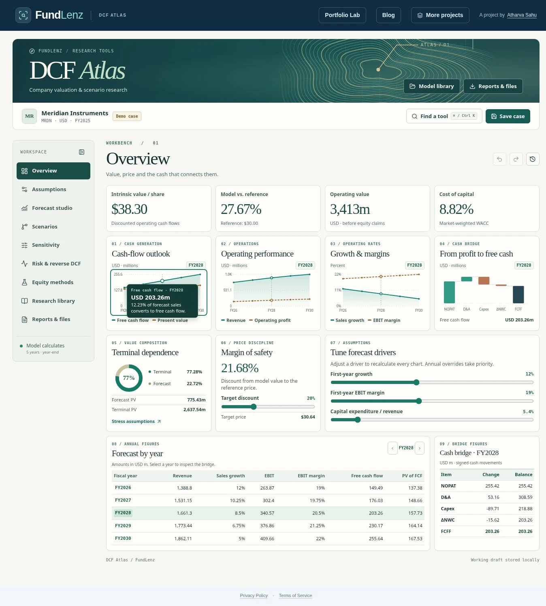

# DCF Atlas

Open **More projects → DCF Atlas** or go directly to **/dcf-atlas**. This is a native FundLenz route. It uses the existing header and securities directory; models, imports and simulations run in the browser. No forecast writes to the catalogue, invokes Gemini, sends files to a server or requires a subscription.

## Try a complete valuation

1. Open the fictional Meridian Instruments case. The overview links the chart's selected year to its operating cash-flow bridge. Expand **Tune forecast drivers** to see the effect of a change. Undo restores the prior model.
2. In **Forecast studio**, override one year of capex; the other years still use the model path. Compare end-of-year and midyear discounting in **Assumptions**.
3. In **Sensitivity**, compare three pairs of drivers. Inspect a cell, adopt its inputs or download a grid. In **Scenarios**, weight the downside, active and upside cases or compare up to four saved snapshots.
4. In **Risk & reverse DCF**, solve for the growth, margin or discount rate required by a target price. Run up to 5,000 correlated trials, inspect exclusions and download the samples. Separately estimate an investor IRR with an explicit purchase price, distributions and exit price.
5. Save a named case. **Research library → Model screener** can filter complete models by gap and terminal contribution, sort results and export the subset. **Reports & files** exports the formula-linked Excel workbook, printable PDF memorandum, offline HTML, model JSON and CSVs.

[Mobile layout](atlas/mobile.webp) · [Sensitivity surface](atlas/sensitivity.webp)

## Data and methods

| Area | What you can use | Where the numbers come from |
| --- | --- | --- |
| Securities | Company/ticker/ISIN/exchange search and stock/ADR filters. A listing starts an empty financial model. | FundLenz's dated reference directory. Its 2026-10-05 snapshot has 5,392 stocks/ADRs. The UI calculates this count from the loaded directory. |
| Filed histories | Three fiscal years of revenue, operating income and cash capex for Apple and Microsoft, plus import of another compatible SEC Company Facts file. | [Apple FY2025 10-K](https://www.sec.gov/Archives/edgar/data/320193/000032019325000079/aapl-20250927.htm), [Microsoft FY2025 10-K](https://www.sec.gov/Archives/edgar/data/789019/000095017025100235/msft-20250630.htm), [SEC API documentation](https://www.sec.gov/search-filings/edgar-application-programming-interfaces). These profiles stop at FY2025; they are not advertised as the latest available filings. |
| Analyst inputs | User-supplied price and date, financial facts, source notes, balance-sheet bridge, WACC, forecast rates and yearly overrides. | Manual inputs or reviewed files. Empty financial values stay unknown. Historical estimates are only adopted by an explicit action; there is no live quote, consensus or FX conversion. |
| Worked cases | Three complete examples for experimenting with a manufacturer, software business or freight operator. | All company names, prices, historicals and forecasts in these cases are fictional. |

Operating enterprise value is the sum of the discounted forecast FCFF and discounted terminal value. FCFF = EBIT − cash taxes + D&A − capital expenditure − change in operating NWC. Cash taxes reflect opening tax losses and forecast operating losses, without expiry or jurisdictional limits. Financing claims and non-operating assets enter only in the equity bridge. Diluted shares and total financial amounts are both expressed in millions.

Select a direct WACC or build it from CAPM, after-tax debt cost and market-value weights. Forecast growth and EBIT margin fade linearly between endpoints unless a year has an override. The perpetuity uses normalized next-year EBIT after tax and reinvestment at stable growth / stable ROIC. It requires stable growth below both WACC and stable ROIC and positive terminal EBIT. The alternative uses a user-supplied final-year EV/EBITDA multiple. Midyear timing shifts explicit cash flows only; both terminal methods discount from the final year-end. See [Damodaran on stable growth](https://pages.stern.nyu.edu/~adamodar/New_Home_Page/valquestions/stablegrowthrate.htm).

Banks, insurers and REITs do not silently use the operating-company model. The separate equity worksheets support dividends, FCFE, AFFO distributions plus sale and residual income. Their cash flows discount at the cost of equity. A peer median uses only positive forward EBITDA and positive EV, reconciled to the active company's equity bridge. A user's real company needs its own equity inputs. The reported price gap and margin of safety use different denominators, explicitly labelled.

The reverse solver scans a bounded interval then bisects valid sign changes; an unreachable target returns no bracketed solution. Monte Carlo uses a recorded seed and input volatilities; invalid trials are counted and excluded. Percentiles describe the chosen experiment, not market-implied probabilities. The holding-period IRR is a separate investor cash-flow calculation, not an expected stock return inferred from FCFF.

## Saving and portability

- The browser maintains a working draft, 60 in-session undo steps and up to 40 named snapshots. JSON and the editable CSV preserve the core model, notes, history, annual overrides and researched peer/equity/lab inputs. Deleting browser storage removes local work unless it was exported.
- CSV/JSON imports display their identity, source, differences and calculation status before application. The downloadable blank and worked templates demonstrate the schema. Financial text cannot introduce an Excel formula through a generated CSV cell.
- SEC file import accepts eligible USD annual 10-K/10-K/A flows with a filing-date cutoff and an exact accession and period match. It will not mix fiscal quarters, join capex from another accession, invent missing currency or value an unrecognized filing. Uploaded files are user-provided evidence.
- The Excel workbook includes Summary, Inputs, Forecast and History. Its formulas and cached values agree with the browser at export. The horizon, terminal method and timing are fixed in that workbook; change them in Atlas and re-export. The printable and offline reports include source notes, assumptions, annual overrides, model checks and entered equity/peer comparisons. Deliberately optional research tools also have dedicated analytical CSV exports.

## Design research

These are public product references, not financial-data feeds. Atlas uses its own code, interface, formulas and graphics.

| Public reference | Design decision in Atlas |
| --- | --- |
| [Alpha Spread](https://www.alphaspread.com/help/what-is-dcf-value), [TIKR model builder](https://www.tikr.com/valuation-model-builder) | Put alternative cases, their cash-flow paths and saved assumptions in the same workspace. |
| [Finbox financial models](https://help.finbox.com/hc/en-us/articles/4405871283729-Working-With-Financial-Models) | Expose applicability checks and export linked formulas, not just a final price. |
| [Simply Wall St valuation methods](https://support.simplywall.st/hc/en-us/articles/4751563581071-Understanding-the-Valuation-section-in-the-company-report) | Offer separate industry-appropriate equity methods and explain the cash flow each discounts. |
| [Stock Unlock](https://www.stockunlock.com/dcf.html), [GuruFocus](https://www.gurufocus.com/tutorial/article/58/gurufocus-dcf-calculator) | Support a growth fade, explicit terminal assumptions and an interactive margin-of-safety threshold. |
| [Stock Analysis](https://stockanalysis.com/tools/dcf-calculator/tutorial/), [InsightDCF](https://www.insightdcf.com/) | Show PV decomposition, sensitivity surfaces, an impact ranking and reproducible distributions. |
| [Fiscal.ai](https://docs.fiscal.ai/docs/guides/mcp-skills), [Koyfin](https://www.koyfin.com/features/) | Connect reverse valuation, investor IRR, peer cross-checks, model screening and exportable research. |

## Verification

Run `pnpm typecheck`, `pnpm verify` and `pnpm build`. The finance suite compares 14 distinct model configurations against a separate Python Decimal implementation and checks closed-form cases, malformed inputs, seeded stress outcomes, filing alignment, worksheet persistence and Excel structure.

To reproduce the browser tests, serve the built Worker using `pnpm start`, install Playwright and its Chromium separately, and run `node scripts/verify-atlas-browser.mjs`. Optional environment variables: `ATLAS_URL`, `ATLAS_PLAYWRIGHT_MODULE`, `ATLAS_CHROMIUM`, `ATLAS_QA_DIR`. The Atlas CI workflow exercises the native route, mobile controls, directory, real downloads and error paths without production credentials.
