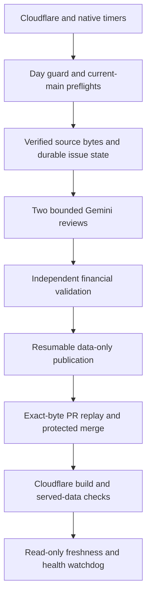

# FundLenz automation resilience review — 5 November 2026

This review covers the executable daily path: Cloudflare dispatcher and timer configuration; GitHub daily/PR/merge/deployment/health workflows; all Python modules in `scripts/automation`; source-adapter dependencies `build_global_holdings.py` and `ucits_holdings.py`; Gemini prompts/contracts; retained-data integrity checks; and the deployment retry script. Application UI, D1/editorial flows and unrelated visitor forms were outside this data-automation change.

The baseline was protected main `254a8a4414518620848ff411d2793c1485f31c6c`. The live external dispatcher is unchanged: it has two timers, no public route and no Gemini/publishing key. Its disabled-by-default checked-in deployment configuration is not a claim about its currently activated Cloudflare environment. No scheduler redeployment or UI/layout changes are required for this patch.

## Trust and execution path

Source identity, complete-portfolio consistency, newest-snapshot precedence and the eight-call daily model cap remain mandatory. Safe independent units may update while blocked units retain their last verified values. Retries cannot authorise publication, change a financial threshold, supply missing evidence, increase quota or bypass branch protection.

## First pass and second pass

The first pass traced every daily module and workflow handoff. The main new findings were unpublished-attempt cadence suppression, non-resumable publication, fragile API throttling/response handling, insufficient merge waiting, and health checks that could accept a green trigger with an old published audit.

The second pass specifically challenged the new code:

- Limit pending-source recovery to facts that differ from committed state, rather than forcing every historical supported source.
- Never silently replace missing unpublished state with an older committed issue queue. Exact published state may be restored from Git; unknown unpublished history requires recovery.
- Keep legacy commit-status readiness separate for every protected context; a late success must not reset an earlier missing/failed gate.
- Freeze both model packets before applying Task A findings. Otherwise deterministic budget trimming could produce a different Task B packet during replay.
- Reconcile acknowledgements for ref, PR and merge writes. Only object creation is safe to retry without observing external state.
- Respect excessive cooldowns by stopping, rather than shortening them into an early request.
- Check actual served data bytes, retain provider-response diagnostics with key redaction, and bound health observation time as well as retry counts.
- Bind evidence to immutable producer attempts; a publisher rerun cannot rewrite the successful collection proof or overwrite collection artifacts.
- Preserve the backup budget only when a completed failed collector is proven not to have started acquisition. Unknown/running histories remain conservative.

## Failure register

**Changed** means this patch adds or tightens handling. **Existing** means existing handling was reviewed and retained, with regression coverage. **Boundary** means automatic success would require guessing, losing history, extra authority or unavailable infrastructure; the correct response is to retain verified data and surface the failure.

| ID | Stage | What can go wrong | Handling | Result |
|---|---|---|---|---|
| F01 | Trigger | Cloudflare timer does not fire | Existing | Independent native GitHub timer; watchdog detects missing runs. Platform-wide outage remains an operator boundary. |
| F02 | Trigger | Native cron arrives hours late | Existing | External 09:17/09:27 IST timers and local-day guard; timing remains best effort. |
| F03 | Trigger | Both timers dispatch the same day | Existing | Serialized workflow and actual collector budget guard prevent duplicate source/model work. |
| F04 | Trigger | A third queued run cancels a pending recovery | Changed | queue: max retains pending runs; source/model preflights reject stale checkouts. |
| F05 | Trigger | An event runs before 09:17 IST | Existing | Guard rejects before acquisition or paid requests. |
| F06 | Trigger | A queue crosses the India-local day boundary | Changed | IST budget accounting plus stale-main preflight; no early or stale-base model calls. |
| F07 | Trigger | Checkout/preflight fails without starting acquisition | Changed | Proven skipped acquisition does not consume a daily request budget; backup remains possible. |
| F08 | Trigger | A collector is still active or its history is ambiguous | Existing | Fail closed; do not manufacture an unused budget. |
| F09 | Trigger | Delayed backup ignores a published recovery | Existing | Exact published run/attempt, chronology and successful recovery collector required. |
| F10 | Trigger | Run history is truncated or from another repository | Existing | Bounded history and repository checks reject ambiguous automatic decisions. |
| F11 | State | Published state artifact expires or disappears | Changed | Use the exact matching committed state, avoiding dependence on artifact retention. |
| F12 | State | Unpublished state artifact expires | Boundary | Stop for explicit history recovery; never silently discard unresolved history. |
| F13 | State | Unpublished collector has no durable state artifact | Changed | Distinguish guard-only runs; missing real-collector state fails closed. |
| F14 | State | State file is truncated during writing | Changed | Temporary file, flush/fsync and atomic replace preserve prior complete bytes. |
| F15 | State | State contains malformed issue/hash/run ledgers | Changed | Validate queue schema, run ledger and source hashes before cadence decisions. |
| F16 | State | State contains a future source-attempt timestamp | Changed | Reject before it can defer a source indefinitely. |
| F17 | State | A failed/unmerged run suppresses a weekly source | Changed | Compare artifact state with committed publication; changed supported sources retry next local day. |
| F18 | State | Pending-source recovery repeatedly runs within one day | Changed | Same-day attempts remain excluded; the daily caps are unchanged. |
| F19 | State | A monitoring endpoint consumes supported-source recovery slots | Changed | Pending-publication forcing applies only to supported adapters; normal monitor rotation remains. |
| F20 | State | Repeated processing increments issue attempts twice | Existing | Applied-run ledger keeps issue reconciliation idempotent. |
| F21 | State | Open issues or large source queues are starved | Existing | Cadence ordering, last-attempt fairness and rotating reinvestigation cursor. |
| F22 | Source | DNS/network/connectivity fails | Existing | Bounded requests, honest unavailable state and retention of verified values; no invented bytes. |
| F23 | Source | A peer drips body data without hitting socket timeout | Changed | Chunked read1 checks a total body deadline and byte limit. |
| F24 | Source | A response is empty, truncated or oversized | Existing | Length/completeness and byte-budget checks reject it; affected data stays unchanged. |
| F25 | Source | A server unexpectedly compresses a source | Existing | Identity encoding required; no unbounded decompression. |
| F26 | Source | A source redirects to an unapproved destination | Existing | Exact allowlist and public-address checks; do not bypass access controls. |
| F27 | Source | A source returns authentication, blocking or quota errors | Boundary | Record unavailable source and retain data; do not rotate credentials or evade blocking. |
| F28 | Source | An issuer serves HTML instead of CSV | Existing | Strict headers, identity, row and completeness checks reject the source. |
| F29 | Source | A changed CSV exposes missing cells or unexpected types | Changed | IndexError, TypeError, csv.Error and non-finite JSON results are contained at the source-adapter boundary. |
| F30 | Source | Coverage or holding-row count collapses | Existing | Whole-source/portfolio rejection; no partial deletion or weight renormalisation. |
| F31 | Source | A value is non-finite, negative or implausibly changed | Existing | Finite arithmetic, positive new NAVs and review thresholds preserve prior values. |
| F32 | Source | A correction is older or conflicts on the same date | Existing | Newest verified snapshot wins; same-date conflicts remain blocked. |
| F33 | Source | An Indian NAV is checked after IST midnight but before UTC midnight | Changed | Indian NAV/new-plan date checks use the India-local check date. |
| F34 | Source | A recycled ticker or changed ISIN is confused with an existing fund | Existing | Exact source/code/class/ISIN identity and new-plan checksum checks. |
| F35 | Source | A new source changes cross-fund identity/classification | Existing | Block the whole conflicting candidate and retain verified classifications. |
| F36 | Gemini | Gemini times out or closes the response early | Changed | Bounded total response time; transient failures share the existing four-attempt task cap. |
| F37 | Gemini | Gemini returns temporary 500/502/503/504 errors | Existing | Bounded exponential service retries; maximum eight model calls per run. |
| F38 | Gemini | Provider requests a longer retry cooldown | Changed | Respect bounded Retry-After; do not shorten an excessive cooldown into an early retry. |
| F39 | Gemini | Key is revoked, model is removed or quota is exhausted | Boundary | Fail honestly; no billing changes, alternate model or extra automatic budget. |
| F40 | Gemini | Provider envelope is null, an array or has malformed parts | Changed | Explicit structural contract errors get one corrective retry within the same cap. |
| F41 | Gemini | Output is truncated or finishes with MAX_TOKENS | Existing | Incomplete output is not accepted as a completed review. |
| F42 | Gemini | Model rewrites retrieval facts, hashes or timestamps | Existing | Runner-owned envelope; exact source IDs/hashes and independent full candidate validation. |
| F43 | Gemini | Issue history grows beyond the request context budget | Changed | Deterministic context trimming with retry headroom; full history retained in audit. |
| F44 | Gemini | Trimming accidentally drops all required review work | Changed | At least a minimal honest source/issue packet must fit; never turn budget failure into empty-work success. |
| F45 | Gemini | Task A changes adapter decisions before Task B replay | Changed | Freeze both trusted packets before applying either model's findings. |
| F46 | Gemini | Prompt injection or unsupported proposals attempt rule changes | Existing | Model has no tools/write credentials; proposals remain untrusted and deterministic rules decide. |
| F47 | Gemini | A model claims a validator false positive or fabricates evidence | Existing | Independent evidence checks; rule review stays blocked without an approved rule change. |
| F48 | Gemini | One mandatory model task fails | Existing | No financial-file emission; report/state remain available for diagnosis. |
| F49 | Gemini | There is genuinely no source/sample/assigned issue to review | Existing | Only exact deterministic empty-work construction avoids a model request. |
| F50 | GitHub | Read transport fails transiently | Existing | Three bounded attempts, fixed host and rejected credential redirects. |
| F51 | GitHub | GitHub explicitly throttles a safe request | Changed | Respect bounded Retry-After for reads/object creation; fail closed on missing or excessive cooldowns. |
| F52 | GitHub | Fast object uploads trip content-generation limits | Changed | At least one second between mutations, in addition to provider cooldowns. |
| F53 | GitHub | Uploading a blob/tree/commit loses the acknowledgement | Changed | Only object creation may replay automatically; no branch or PR is moved by an orphan object. |
| F54 | GitHub | A ref-creation acknowledgement is lost | Changed | Observe the exact existing ref before retrying; conflicting refs are never overwritten. |
| F55 | GitHub | A PR-creation acknowledgement is lost | Changed | Find the exact actor/head/base PR before retrying; no blind duplicate creation. |
| F56 | GitHub | Publisher job is rerun after a partial upload | Changed | Reuse the exact artifact tree and original parent, then resume the same branch/PR. |
| F57 | GitHub | Publisher job is rerun after its PR merged | Changed | Recognise the exact merged publication without creating another PR. |
| F58 | GitHub | A same-named branch has different bytes or ancestry | Changed | Reject; never reset, force-push or overwrite it. |
| F59 | GitHub | Publication was closed without merging or duplicated manually | Boundary | Retain for explicit review; do not reopen or silently choose a different PR. |
| F60 | GitHub | Main advances while acquisition or review is queued | Changed | Read-only preflights before sources and before paid review avoid wasted calls on a known-stale checkout. |
| F61 | GitHub | Main advances after the final preflight | Boundary | Exact-base publisher, replay gate and merge checks still stop it; fresh reconciliation is required. |
| F62 | Merge | Required checks take longer than three minutes | Changed | Bounded ten-minute polling with a job timeout that permits it. |
| F63 | Merge | Protection adds another required check or legacy status | Changed | Inspect every current protected context, including configured app identities and latest status. |
| F64 | Merge | A previous green check has a newer red result | Existing | Latest exact-head result wins; no aggregate-clean shortcut or protection bypass. |
| F65 | Merge | Successful legacy status accidentally overrides another missing gate | Changed | Readiness is accumulated per context; second-pass regression covers mixed legacy contexts. |
| F66 | Merge | Head/base moves while waiting | Existing | Every attempt checks exact head/base, actor and protected main again. |
| F67 | Merge | Merge succeeds but its reply is lost | Changed | Observe exact merged PR before another attempt; preserve a bounded uncertain-outcome failure. |
| F68 | Merge | Reviews or permissions deny the merge | Boundary | GitHub protections remain authoritative; no self-approval or force merge. |
| F69 | Hosting | Wrangler encounters a recognised transient transport error | Existing | Retry the same built artifact up to three times; no rebuild or config changes. |
| F70 | Hosting | Build fails permanently or Cloudflare is unavailable | Boundary | Retain last deployment and report unconfirmed; no fabricated deployment or automatic rollback of data. |
| F71 | Hosting | A foreign app spoofs the Cloudflare check name | Changed | Deployment observer also requires the Cloudflare app identity. |
| F72 | Hosting | Cloudflare build is green but old release/date is served | Existing | Exact public release/date probes with bounded propagation retries. |
| F73 | Hosting | Release marker is new but cached financial assets are old | Changed | Hash actual NAV catalogue, holdings index and up to three accepted portfolio assets. |
| F74 | Hosting | Build-status API briefly fails during observation | Changed | Keep probing within the same bounded observation window, with safe error categories. |
| F75 | Hosting | Audit-only publication is confused with new financial data | Existing | No false catalogue-date advance or claim of a financial deployment. |
| F76 | Monitoring | Daily workflow is green but data PR never publishes | Changed | Require a matching protected published audit no older than 36 hours. |
| F77 | Monitoring | A completed daily/deployment run is not checked until the next cron | Changed | Read-only health workflow also runs on workflow completion; scheduled checks remain. |
| F78 | Provenance | Reruns obscure the original successful producer attempt | Changed | Immutable attempt metadata/jobs and producer-attempt binding; full collection recovery uses a fresh dispatch. |
| F79 | Required check | Recording the required gate succeeds but its reply is lost | Changed | Observe the exact trusted head/outcome/workflow check before retrying; a head race records failure. |
| F80 | Platform | Actions startup/event delivery fails before jobs exist | Boundary | Missing required checks remain blocking; re-trigger a reviewed PR event or fresh dispatch without fabricating a green result. |
| F81 | Required check | GitHub canonicalises a check display URL | Changed | Receipt identity uses exact head, trusted app and result; a display-only URL is not treated as validation authority. |

## Verification and simulations

- `python3 -m unittest discover -s scripts/automation/tests`: 164 test methods, including the existing adversarial validator cases and new hardening regressions.
- `test_unattended_hardening.py`: 625 deterministic mixtures of success, 503, timeout, contract failure and authentication failure; plus 32 combinations of lost ref/PR acknowledgements, repeated publisher calls and merged states. These 657 simulated sequences do not make network calls or spend Gemini quota.
- Fault tests also cover atomic-write failure, dripping responses, cooldown parsing, expired/missing state, weekly-source recovery, stale checkouts, future state times, malformed issuer/provider shapes, exact PR/tree reuse, required-check/app identity, legacy status interactions, lost merge responses and stale served data.
- Fourteen Node scheduler/deployment tests, nineteen JSON contract checks, reviewed-file integrity, TypeScript no-emit and all six finance/catalogue suites are included in acceptance. The finance suites currently count 1,285,765 checks plus directory assertions.
- Production acceptance uses the ordinary trusted main workflow, mandatory live Gemini reviews, independent exact-byte replay, protected data PR merge, and the Cloudflare/served-data observer. Unit tests alone are not evidence that a later unattended timer fired.

During maintenance acceptance, an initial trusted-data-review run stopped with `startup_failure` before creating jobs; the reopened PR event completed the review normally. Required checks remain authoritative even when event delivery is delayed.

Current run/PR evidence is available in the repository's [Actions history](https://github.com/atharv3169/FundLenz/actions) and associated maintenance/data PRs. This document intentionally separates simulated cases from live platform execution.

## Remaining operating boundaries

No code can guarantee a successful daily publication during a provider-wide outage, an expired/revoked credential, unavailable quota, an unreviewed source format, a conflicting financial snapshot, lost unpublished history or an unsatisfied protected review. These cases remain visible failures rather than permission to publish unverifiable data.

A main-branch change after the final preflight still invalidates the candidate. A source run crossing midnight may need fresh reconciliation to preserve the release-date rule. The next local-day supported-source retry avoids turning an unpublished attempt into a week-long cadence delay. Collection job reruns intentionally require a fresh main dispatch; publisher/merge retries may resume exact validated evidence. There is no unbounded whole-workflow retry or silent increase in the eight-call model budget.

The served-data probe is representative, not a redownload of all 2,000+ public files: all changed bytes are checked at the trusted PR gate, while hosting verification probes the NAV catalogue, holdings index and at most three accepted portfolio assets. A byte-level outage confined to another static asset needs a targeted investigation.

Socket inactivity plus body deadlines bound ordinary slow responses. OS DNS/TLS/header stalls and abrupt runner termination also remain bounded by workflow/job timeouts. An unexpected timeout can still stop a run; it must not result in a false success marker.

## Primary platform references

- [GitHub workflow concurrency and queue behaviour](https://docs.github.com/en/actions/reference/workflows-and-actions/workflow-syntax#concurrency): queueing prevents replacement of a pending run; it does not guarantee dispatch time.
- [GitHub REST best practices](https://docs.github.com/en/rest/using-the-rest-api/best-practices-for-using-the-rest-api): serialized mutations, spacing and respecting cooldowns.
- [Cloudflare Cron Triggers](https://developers.cloudflare.com/workers/configuration/cron-triggers/): independent scheduled execution and observability; changes to trigger configuration are a separate deployment.
